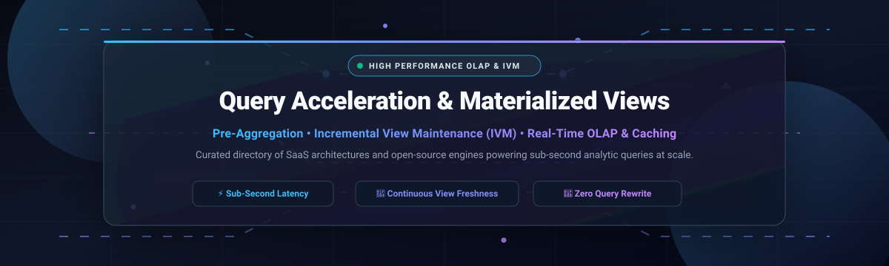

<div align="center">



# ⚡ Awesome Query Acceleration & Materialized Views 🚀

<a href="https://github.com/ishandutta2007/Awesome-Awesome-Awesome"></a><a href="https://discord.gg/jc4xtF58Ve"></a>
[](https://awesome.re)
[](https://creativecommons.org/publicdomain/zero/1.0/)
[](https://github.com/ishandutta2007/Awesome-Query-Acceleration-Materialized-Views/pulls)
[](https://github.com/ishandutta2007/Awesome-Query-Acceleration-Materialized-Views)
<a href="https://github.com/ishandutta2007"></a>

**A comprehensive, curated directory of SaaS data platforms and high-performance open-source engines for Query Acceleration, Incremental View Maintenance (IVM), Pre-Aggregation, and Real-Time OLAP.**

</div>

---

## 📑 Table of Contents
- [📌 Overview & Architectural Mechanics](#-overview--architectural-mechanics)
- [📊 Sector Overview & Market Dynamics](#-sector-overview--market-dynamics)
- [☁️ SaaS & Hosted Platforms](#-saashosted-platforms)
- [🔓 Open-Source GitHub Projects](#-open-source-github-projects)
  - [⚡ Top Open-Source Engines (Ranked by Stars)](#-top-open-source-engines-ranked-by-stars)
  - [⚙️ Additional Specialized Engines](#-additional-specialized-engines)
- [🔍 Workload Selection Guide](#-workload-selection-guide)
- [🤝 How to Contribute](#-how-to-contribute)
- [💖 Support](#-support)
- [⭐ Star History](#-star-history)
- [⚠️ Disclaimer](#-disclaimer)

---

## 📌 Overview & Architectural Mechanics

Query acceleration platforms eliminate expensive multi-table joins, window functions, and high-cardinality group-by scans by maintaining precomputed state. When an application or BI client issues SQL queries, an intelligent query optimizer automatically inspects available materialized views (MVs), projections, or pre-aggregated cubes and transparently rewrites queries to execute in sub-second time without altering client applications.

Modern query acceleration encompasses three core paradigms:
1. **🔄 Incremental View Maintenance (IVM):** Continuous differential state streaming that processes only modified records and state changes (deltas), ensuring sub-second view freshness without expensive batch table recalculations.
2. **📈 Insert Trigger & Projection Materialization:** Micro-batched inserts that stream append-only blocks directly into pre-aggregated target tables (e.g., ClickHouse `AggregatingMergeTree`), coupled with localized sorting projections for alternate access patterns.
3. **🧊 Lakehouse & Semantic Pre-Aggregation:** Asynchronous semantic-layer cubes and lakehouse caching layers (e.g., Apache Iceberg/Parquet integration) providing transparent cost and latency optimization across massive cold object storage.

---

## 📊 Sector Overview & Market Dynamics

The specialized **Query Acceleration, Materialized Views, and High-Performance Real-Time OLAP** market represents a vital, high-growth segment within the broader real-time analytics market (valued at **$51.36B in 2024** and projected to exceed **$150B by 2030**), with the dedicated in-memory and real-time analytical database tier surpassing **$11B in 2025**.

The sector exhibits **moderate fragmentation with strong consolidation dynamics** around cloud infrastructure giants, while preserving deep technical niches:
- **Concentrated Cloud Layer:** Hyperscale cloud data warehouses (Snowflake, Databricks, BigQuery) dominate multi-tenant enterprise data estates and general BI workloads.
- **Fragmented Real-Time & High-Concurrency Tier:** Demands for user-facing, sub-second latency, streaming joins, and observability have created thriving, specialized categories led by vectorized OLAP engines (ClickHouse, StarRocks, Apache Doris) and continuous differential stream maintainers (RisingWave, Materialize, Feldera), ensuring pure-play query acceleration remains highly competitive and resistant to single-vendor capture.

---

## ☁️ SaaS/Hosted Platforms

The following hosted SaaS engines, managed cloud warehouses, and enterprise acceleration services are ranked in descending order by parent company scale (valuation / market capitalization).

| 🏢 Platform | 💰 Scale (Company Valuation / Market Cap) | 🏷️ Starting Pricing Tier | 🎁 Free Tier Limit / Free Trial Duration | 🎯 Primary Acceleration Focus & MV Mechanism |
| :--- | :--- | :--- | :--- | :--- |
| **[Snowflake Materialized Views](https://docs.snowflake.com/en/user-guide/views-materialized)** | **$108.0B+** *(NYSE: SNOW Market Cap)* | **$2.00 / credit** *(Standard Edition on-demand baseline rate)* | **30-day free trial** with **$400 in usage credits** (no credit card required) | Automated background serverless compute maintenance; query optimizer rewrites queries matching single-table additive aggregations. |
| **[ClickHouse Cloud](https://clickhouse.com/docs/en/sql-reference/statements/create/view#materialized-view)** | **$15.0B** *(Series D valuation; $250M+ ARR)* | **$0.18 / ClickHouse Compute Unit (CCU) / hour** *(Basic tier pay-as-you-go)* | **30-day free trial** with **$300 in free cloud usage credits** | Vectorized insert triggers to explicit target tables (`AggregatingMergeTree`) and projections for alternate sort orders. |
| **[Firebolt](https://www.firebolt.io/)** | **$1.4B** *(Series C valuation; ~$40M estimated ARR)* | **$0.92 / engine hour** *(Billed per second with auto-stop/resume)* | **Free trial** with **$200 in free evaluation credits**; permanent free self-hosted Firebolt Core | Columnar query engine with sparse indexing, aggregating indexes, and decoupled compute engines tuned for interactive BI data marts. |
| **[SingleStore Helios](https://www.singlestore.com/)** | **$1.3B** *(PE buyout valuation; $123M+ ARR)* | **$0.99 / hour** *(Helios S-00 Standard 2 vCPU compute instance)* | **Forever Free Tier** limited to **1 GB compressed data** (~4 GB raw); or 30-day trial with **$600 credits** | Hybrid transactional/analytical processing (HTAP) with universal storage and sub-millisecond in-memory table acceleration. |
| **[Imply Polaris](https://imply.io/)** | **$1.1B** *(Series D unicorn valuation; Apache Druid creator)* | **$0.14 / Imply Compute Unit (ICU) / hour** *(Elastic real-time tier)* | **30-day free trial** with **$500 credits**, 1 project limit, waived streaming ingestion fees | Fully managed Apache Druid cloud service featuring ingestion rollup, segment immutable caching, and user-facing dashboards. |
| **[Yellowbrick](https://www.yellowbrick.com/)** | **~$700M** *(Series C enterprise valuation; $292M total raised)* | **$0.28 / vCPU / hour** *(Software on-demand pay-as-you-go)* | **30-day free trial** for cloud deployments (AWS / Azure / GCP) | MPP analytic warehouse designed for hybrid multi-cloud and on-premises deployments with hardware-accelerated execution. |
| **[Materialize Cloud](https://materialize.com/)** | **$600M** *(Series D valuation; $100M+ total raised)* | **Usage-based credits** *(Starting at ~$0.40 / compute credit / hour)* | **7-day free trial** (max 4 credits/hour consumption rate limit); forever free developer emulator | Continuous Incremental View Maintenance (IVM) built on Timely and Differential Dataflow for sub-second, strictly serializable joins. |
| **[StarTree Cloud](https://startree.ai/)** | **~$480M** *(Series B valuation; $75M total raised)* | **Tiered compute starting at ~$1.20 / hour** *(Contact / marketplace quote)* | **14-day free trial** available via custom onboarding & AWS/GCP marketplace | Cloud-native Apache Pinot platform providing StarTree ThirdEye anomaly detection and high-concurrency p99 latency guarantees. |
| **[Hydrolix](https://hydrolix.io/)** | **~$350M** *(Series C valuation; $148M total raised)* | **$0.20 / GB ingested** *(Self-Managed BYOC); $0.31 / GB (SaaS)* | **7-day free trial** via AWS Marketplace and managed trials upon signup | Log-optimized streaming platform on ClickHouse SQL engine with decoupled compute pools and lossless compression. |
| **[CrateDB Cloud](https://crate.io/)** | **~$85M** *(Series B funding valuation; $33M total raised)* | **$0.12 / cluster hour** *(CR-0 Shared instance configuration)* | **14-day free trial** with access to shared clusters and full console features | Distributed SQL database built on Lucene inverted indexes; official open migration destination for Rockset workloads. |

---

## 🔓 Open-Source GitHub Projects

Explore the most popular open-source query acceleration engines, incremental view maintenance databases, and analytical layer frameworks.

### ⚡ Top Open-Source Engines (Ranked by Stars)

The following open-source query acceleration repositories are sorted in descending order by GitHub stargazers count:

1. **[ClickHouse](https://github.com/ClickHouse/ClickHouse)**  
   [](https://github.com/ClickHouse/ClickHouse/stargazers)  
   The industry-standard open-source columnar database management system (DBMS) designed for real-time analytical reporting. Employs vectorized SIMD execution, **materialized views functioning as stream insert triggers** into target tables, and **projections** for transparent, multi-dimensional query routing without query modifications.

2. **[DuckDB](https://github.com/duckdb/duckdb)**  
   [](https://github.com/duckdb/duckdb/stargazers)  
   An in-process SQL OLAP database management system built for analytical query acceleration. Features vectorized query processing, single-file zero-copy architecture, instant parquet acceleration, and client-side materialized view caching inside Python, R, Node, and browser WASM runtimes.

3. **[Cube](https://github.com/cube-js/cube)**  
   [](https://github.com/cube-js/cube/stargazers)  
   Universal semantic layer and pre-aggregation query acceleration engine. Automatically translates raw analytics requests into pre-aggregated summary tables across multiple data stores, orchestrating background warming, rollup hierarchies, and transparent SQL rewriting.

4. **[Apache Doris](https://github.com/apache/doris)**  
   [](https://github.com/apache/doris/stargazers)  
   A high-performance, real-time analytical data warehouse based on MPP technology. Offers MySQL wire compatibility, **asynchronous & synchronous materialized views**, inverted indexing, automated query rewriting, and sub-second analytical aggregations over massive datasets.

5. **[Apache Druid](https://github.com/apache/druid)**  
   [](https://github.com/apache/druid/stargazers)  
   High-performance real-time analytics database built for streaming event ingestion and fast ad-hoc queries. Incorporates immutable column-oriented segments with automatic ingestion-time rollups, bitmap indices, and caching for high-concurrency event telemetry.

6. **[StarRocks](https://github.com/StarRocks/starrocks)**  
   [](https://github.com/StarRocks/starrocks/stargazers)  
   Next-generation sub-second OLAP lakehouse engine. Features asynchronous multi-table materialized views, cost-based optimizer (CBO) query rewriting, SIMD vectorization, and direct query acceleration over Apache Iceberg, Delta Lake, and Hudi.

7. **[Apache DataFusion](https://github.com/apache/datafusion)**  
   [](https://github.com/apache/datafusion/stargazers)  
   Extensible query engine written in Rust using Apache Arrow format as memory state. Frequently embedded to construct customized query acceleration layers, in-memory partition caches, and specialized vectorized analytical engines.

8. **[RisingWave](https://github.com/risingwavelabs/risingwave)**  
   [](https://github.com/risingwavelabs/risingwave/stargazers)  
   Leading open-source distributed SQL streaming database (Apache 2.0). Provides **true Incremental View Maintenance (IVM)** with continuous state maintenance, sub-second freshness, multi-table streaming joins, cascading views, and native Apache Iceberg lakehouse integration.

9. **[Materialize (Source-Available)](https://github.com/MaterializeInc/materialize)**  
   [](https://github.com/MaterializeInc/materialize/stargazers)  
   Streaming SQL database powered by Timely and Differential Dataflow. Maintained under the Business Source License (BSL), offering strictly serializable ACID consistency across dynamic multi-table materialized views.

10. **[Apache Pinot](https://github.com/apache/pinot)**  
    [](https://github.com/apache/pinot/stargazers)  
    Real-time distributed OLAP datastore originated at LinkedIn. Designed to execute low-latency, user-facing analytical queries with StarTree index pre-aggregation, multi-tenant resource isolation, and horizontal scale.

11. **[Apache Calcite](https://github.com/apache/calcite)**  
    [](https://github.com/apache/calcite/stargazers)  
    Dynamic data management framework providing the foundational query optimization and **materialized view query rewriting algorithms** (lattice recognition, pull-up, push-down) implemented across Snowflake, Drill, and Hive.

12. **[CrateDB](https://github.com/crate/crate)**  
    [](https://github.com/crate/crate/stargazers)  
    Distributed SQL database combining the simplicity of SQL with the horizontal scaling and indexing power of Elasticsearch/Lucene. Frequently adopted as an open-source migration alternative for discontinued Rockset installations.

13. **[Feldera](https://github.com/feldera/feldera)**  
    [](https://github.com/feldera/feldera/stargazers)  
    Fast engine for continuous analytics and incremental computation based on DBSP theory. Computes arbitrary recursive and non-recursive SQL queries over streaming inputs with minimal memory overhead.

14. **[pg_ivm](https://github.com/sraoss/pg_ivm)**  
    [](https://github.com/sraoss/pg_ivm/stargazers)  
    PostgreSQL extension that introduces Incremental View Maintenance (IVM). Automatically updates materialized view contents immediately when base tables are modified via DML, avoiding full `REFRESH MATERIALIZED VIEW` commands.

---

### ⚙️ Additional Specialized Engines

- **[Hydrolix](https://hydrolix.io/)** — Stateless ClickHouse-powered streaming log lakehouse designed for high-cardinality indexing and extreme write throughput.
- **[Yellowbrick](https://www.yellowbrick.com/)** — Enterprise data warehouse engineered for hybrid multi-cloud and bare-metal environments requiring ultra-low latency SQL execution.
- **[SingleStore](https://www.singlestore.com/)** — Distributed relational database optimized for concurrent ingestion, real-time analytics, and transactional low latency.

---

## 🔍 Workload Selection Guide

Selecting the appropriate query acceleration architecture requires aligning your workload characteristics with engine execution models:

```
Workload Pattern                      Recommended Architecture / Engine
----------------------------------------------------------------------------------------------------
Continuous Streaming Joins (IVM)   --> RisingWave (Apache 2.0), Materialize (BSL), Feldera
Extreme Single-Table Aggregations  --> ClickHouse (MergeTree & Projections), DuckDB
Multi-Table Lakehouse Acceleration --> StarRocks, Apache Doris, Apache DataFusion
High-Concurrency User Dashboards   --> Apache Pinot (StarTree Index), Apache Druid
Semantic Pre-Aggregation / Metrics --> Cube, Apache Calcite
Embedded / In-Process Analytics    --> DuckDB, Apache DataFusion
Enterprise Managed Cloud Warehouse --> Snowflake (Single-table MVs), Firebolt, SingleStore
```

---

## 🤝 How to Contribute

Contributions are warmly welcomed! Help keep this ecosystem guide up-to-date:

1. **Fork** the repository.
2. **Add or enhance** platform and engine entries (ensure pricing, GitHub stars, and architectural specifics are accurate).
3. Follow the established markdown format and verify all links.
4. Open a **Pull Request** with a concise description of your changes.

⭐ **If this directory helps your data architecture decisions, please give it a star!**

---

## 💖 Support

A huge thank you to everyone exploring, adopting, and advancing the modern query acceleration ecosystem! 

If you find this repository valuable:
- ⭐ **Star** this repository on GitHub to help others discover it.
- 🍴 **Fork** and contribute additions, updates, or benchmark findings.
- 📢 **Share** this list with fellow data engineers, architects, and analytics teams.
- ☕ **Buy a coffee / Sponsor**: Support ongoing maintenance and curation via the [GitHub Sponsors Dashboard](https://github.com/sponsors/ishandutta2007).

---

## ⭐ Star History

[](https://star-history.dera.page/#ishandutta2007/Awesome-Query-Acceleration-Materialized-Views&type=date&legend=top-left)

---

## ⚠️ Disclaimer

- This curated list is maintained by the community for educational and architectural evaluation purposes; inclusion does not constitute a commercial endorsement.
- Materialized views and pre-aggregated caches store derived data representations. Always verify that organization-wide security boundaries, row-level security (RLS), and column masking policies are consistently respected by optimizer rewrites.
- Product pricing, trial allocations, and corporate valuations reflect publicly available market intelligence and are subject to change by respective vendors.

---

<div align="center">
  <b>Built for Data Architects, Analytics Engineers, and High-Performance Infrastructure Teams.</b>
</div>
